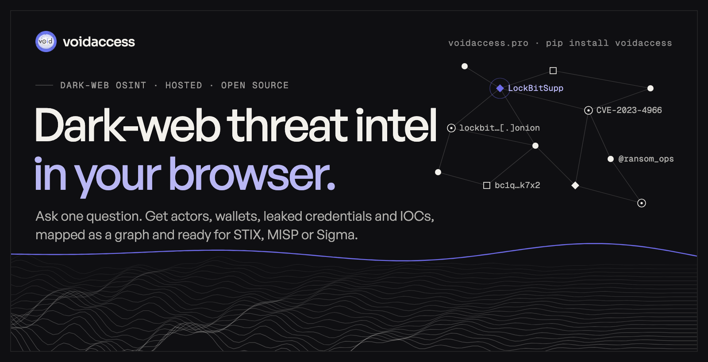
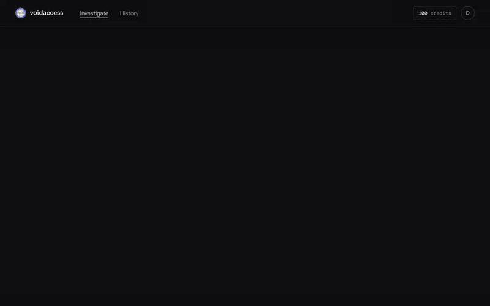
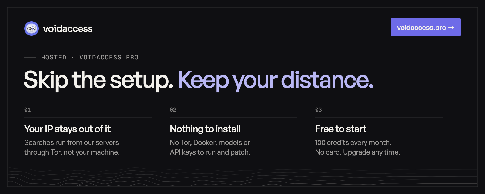
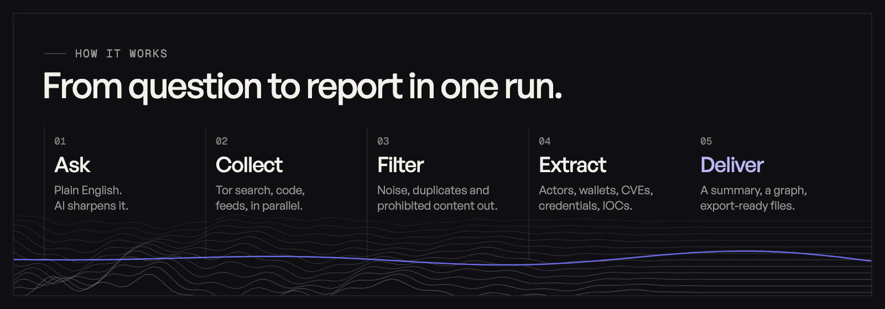
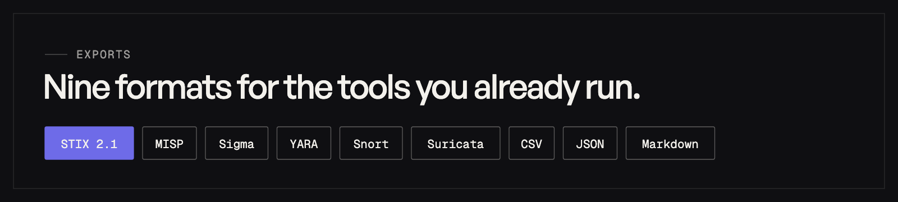
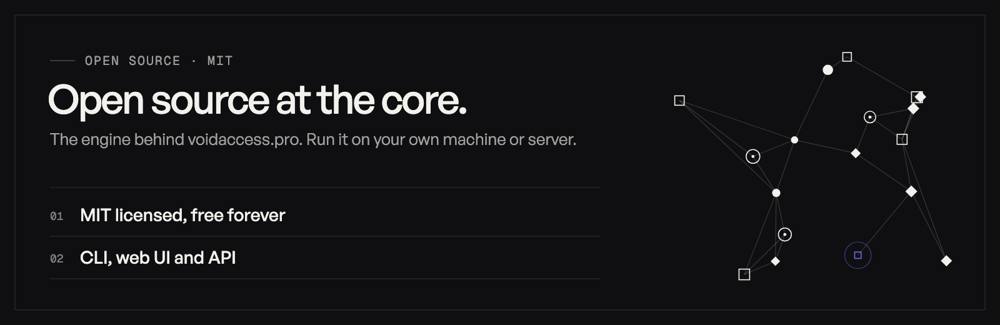

<p align="center">
  <a href="https://voidaccess.pro/?ref=github"></a>
</p>

<p align="center">
  <a href="https://voidaccess.pro/?ref=github"></a>
  <a href="https://pypi.org/project/voidaccess/"></a>
  <a href="https://pypi.org/project/voidaccess/"></a>
  <a href="https://github.com/KatrielMoses/VoidAccess/stargazers"></a>
  <a href="LICENSE"></a>
</p>

<p align="center">
  <b>Ask one question. Get a sourced report, a graph you can search, and IOCs you can load.</b><br>
  For security researchers, threat-intel teams, MSSPs and authorized investigators.
</p>

<p align="center">
  <a href="https://voidaccess.pro/?ref=github"><b>Use it hosted → voidaccess.pro</b></a>
  &nbsp;·&nbsp;
  <a href="#run-it-yourself"><b>Run it yourself → <code>pip install voidaccess</code></b></a>
</p>

<p align="center">
  
</p>

## Hosted, at voidaccess.pro

<a href="https://voidaccess.pro/?ref=github"></a>

The hosted version runs this engine for you. Searches and page fetches go out from our servers through Tor, so your research doesn't start from your laptop or office network. A live view shows every link found, kept or discarded (duplicates, 404s, timeouts, the safety filter), then the results open as a graph with every value searchable by category.

**[Start free at voidaccess.pro →](https://voidaccess.pro/?ref=github)**

## How it works



One query fans out in parallel to 12+ Tor search engines, code hosts, security feeds and curated `.onion` seeds, then follows new `.onion` links as it finds them. Prohibited queries, URLs and content are dropped at mandatory safety gates. The full pipeline, with timeouts and recovery, is in [Architecture](docs/architecture.md).

## What it finds

| Category | Examples |
|---|---|
| Threat actors | Actor handles, ransomware groups, malware families, MITRE ATT&CK techniques |
| Infrastructure | IPv4/IPv6, domains, URLs, `.onion` addresses, file hashes |
| Crypto wallets | Bitcoin, Ethereum, Monero, Litecoin, Zcash, Solana, Tron and more |
| Credentials | Cloud keys, tokens, JWTs, API keys, stealer-log and combo-list entries (masked) |
| Messaging | Telegram, Discord, XMPP, Tox, Session, Matrix, Wire, ICQ, Wickr |
| Vulnerabilities | CVEs, Exploit-DB IDs |

Entities are linked into a relationship graph with communities and infrastructure clusters, and cross-referenced against earlier findings.



## Run it yourself



```bash
pip install voidaccess
voidaccess configure                      # LLM provider, enrichment keys, Tor
voidaccess investigate "LockBit ransomware"
voidaccess export <id> --format stix     # stix, misp, sigma, yara, snort, suricata, package, csv, md, json
```

No Tor or LLM key yet? `voidaccess investigate "LockBit ransomware" --no-llm --no-tor --depth shallow` runs a clearnet-only pass. For the full stack (PostgreSQL, Tor, API and web UI) with Docker Compose, see the [self-hosting guide](docs/self-hosting.md). Python 3.10+.

<details>
<summary><b>CLI reference</b></summary>

| Command | Description |
|---------|-------------|
| `voidaccess investigate "QUERY"` | Run an investigation |
| `voidaccess show` | Open the interactive entity browser |
| `voidaccess export ID --format FORMAT` | Export as STIX, MISP, Sigma, YARA, Snort, Suricata, package, CSV, Markdown or JSON |
| `voidaccess package ID` | Build an IOC package ZIP |
| `voidaccess enrich ID` | Re-enrich a saved investigation |
| `voidaccess list` | List saved investigations |
| `voidaccess status` | Show configuration, Tor, cache, engine and seed status |
| `voidaccess actors` | List persistent actor profiles |
| `voidaccess actor HANDLE [--timeline] [--note "TEXT"]` | Show an actor, its timeline, or add a note |
| `voidaccess configure [llm \| keys \| tor]` | Run the setup wizard, or one part of it |
| `voidaccess version` | Print the installed version |

Optional clearnet requests can use [ScrapingAnt](https://scrapingant.com/?ref=mzliyzh) with `--use-scraping-api` or `--use-proxies`; Tor, `.onion`, GitHub and GitLab traffic are unaffected.
</details>

<details>
<summary><b>Sources and enrichment</b></summary>

| Layer | Sources |
|---|---|
| Dark-web search | 12+ Tor search engines and curated `.onion` seeds |
| Open-web collection | Paste sites, GitHub, GitLab and curated RSS feeds |
| Threat feeds | AlienVault OTX, abuse.ch (MalwareBazaar, ThreatFox, URLhaus), CISA KEV |
| IP and domain context | Shodan InternetDB, GreyNoise, AbuseIPDB, Feodo Tracker, crt.sh, URLScan.io, Wayback Machine, CIRCL PDNS, RDAP |
| File and identity context | VirusTotal, Hybrid Analysis, Have I Been Pwned, EmailRep |
| Blockchain | BlockCypher and Etherscan |

Sources that need an API key are skipped cleanly without one. The hosted version uses a subset whose terms allow it. Full configuration: [Architecture](docs/architecture.md#13-configuration-reference). For full sentence-transformer embeddings, `pip install "voidaccess[nlp]"`; without it, a deterministic fallback encoder is used.
</details>

<details>
<summary><b>LLM providers</b></summary>

| Provider | Typical models | Notes |
|---|---|---|
| OpenRouter | DeepSeek, Llama, Claude | Default route; free models available |
| Groq | Llama | Fast hosted inference with a free tier |
| OpenAI | GPT models | API key required |
| Anthropic | Claude | Claude Haiku is the tested default |
| Google Gemini | Gemini Flash and Pro | Google AI Studio key required |
| Ollama | Any installed local model | Local, suitable for air-gapped deployments |
</details>

## Links

[voidaccess.pro](https://voidaccess.pro/?ref=github) · [Self-hosting](docs/self-hosting.md) · [Architecture](docs/architecture.md) · [Contributing](CONTRIBUTING.md) · [Security](SECURITY.md) · [Usage policy](docs/USAGE_POLICY.md) · [PyPI](https://pypi.org/project/voidaccess/)

## License

MIT. Use VoidAccess only for authorized security research and threat-intelligence work; see the [Usage Policy](docs/USAGE_POLICY.md).
